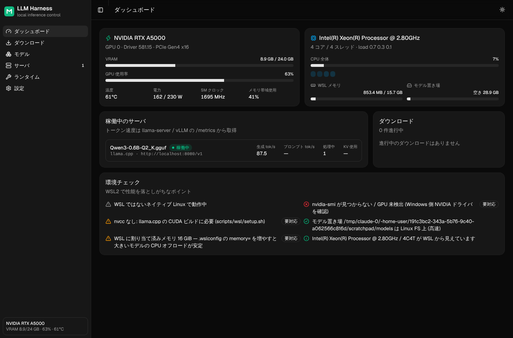
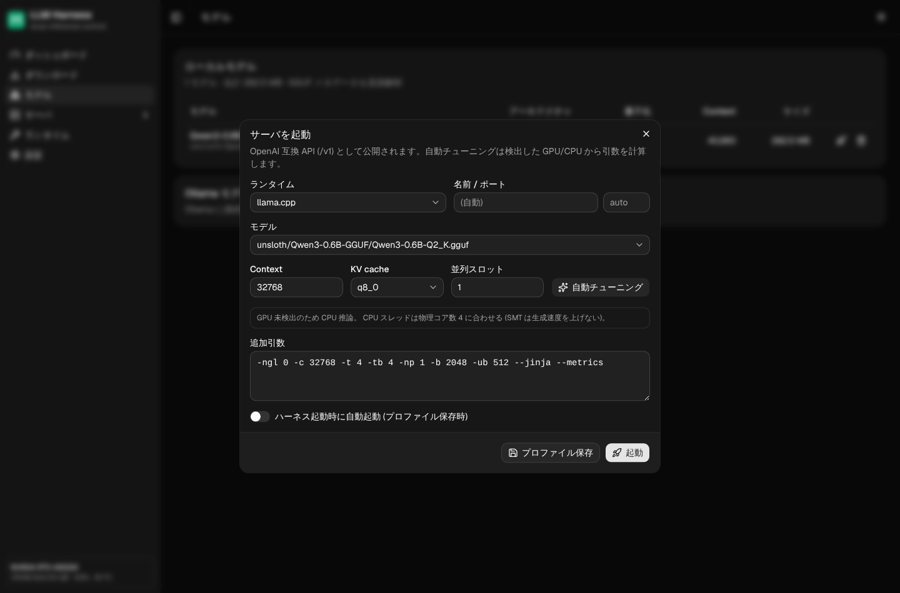

# LLM Harness

ローカル LLM ランタイム (**llama.cpp / vLLM / Ollama**) を 1 つの Web UI から管理する統合ハーネス。
Windows + **WSL2** 上で NVIDIA GPU と多コア CPU を使い切ることを目標にしています
(想定環境: Lenovo ThinkStation P620 / Threadripper PRO 5000WX / RTX A5000)。

バックエンドは **Rust** (axum / tokio、`opt-level=3` + fat LTO、単一バイナリにフロントを埋め込み)、UI は React + [shadcn/ui](https://ui.shadcn.com)。




<details><summary>起動ダイアログ (自動チューニング)</summary>



</details>

## できること

| 機能 | 内容 |
| --- | --- |
| **ダウンロード管理** | Hugging Face 検索 → 量子化を選んでキュー投入。1 ファイルを最大 N 本の HTTP Range 接続で並列取得、一時停止 / 再開 / キャンセル、ハーネスや WSL を再起動しても途中から再開、完了時に sha256 検証。分割 GGUF (`-00001-of-0000N`) は自動でまとめて選択。Ollama の `pull` も同じキューで進捗表示 |
| **モデル在庫** | `~/models` を走査し、GGUF ヘッダを直接パースしてアーキテクチャ / 量子化 / context 長 / MoE expert 数 / ビジョン (mmproj) を表示。safetensors ディレクトリは vLLM 用として認識 |
| **自動チューニング** | 検出した VRAM 空き容量・CPU コア数とモデルのメタデータから KV キャッシュ量を計算し、`-ngl` / `--n-cpu-moe` / `-t` / `-tb` / `-fa` / `-ctk -ctv` / バッチサイズを提案 (後述) |
| **サーバ管理** | llama-server / vLLM / ollama serve を子プロセスとして起動・停止、ログのライブ表示、`/metrics` から生成 tok/s・プロンプト tok/s・KV 使用率を表示。設定はプロファイル保存でき、ハーネス起動時に自動起動も可 |
| **ランタイム管理** | 各ランタイムの導入状況とバージョンを表示し、llama.cpp の CUDA ビルドや vLLM の導入/更新を UI から実行 |
| **テレメトリ** | GPU (VRAM / 使用率 / 温度 / 電力 / クロック / PCIe リンク)、CPU コア別使用率、WSL メモリ、ディスク |
| **環境チェック** | WSL で性能を落としがちな設定 (モデルが `/mnt/c` 上にある、nvcc 無し、メモリ割り当て不足、Linux 用 libcuda 混入など) を警告 |
| **FULL / SHARED モード** | ヘッダーのスイッチ 1 つで切替。**FULL**: 全コア・全 VRAM・GPU 電力 100% で最大性能。**SHARED**: CPU の半分 (物理コア単位) を残し、VRAM を予約、GPU 電力を制限、`nice` を下げ、DL 帯域も制限してワークステーションを普通に使えるようにする。稼働中サーバの CPU affinity / 優先度は即時反映し、引数 (`-t` / `-ngl` / `-ub`) はモードに合わせて再計算 (再起動で反映)。時間帯スケジュールも可 |
| **リモートアクセス** | Cloudflare Tunnel (quick / token) または ngrok でポート開放なしに公開。外部端末からはログイン (パスワード + 任意の TOTP) 後にコントロールパネルを操作。認証未設定ではトンネルを起動しない |
| **モデルカタログ** | Hugging Face の trending / 新着 / DL 数順から、VRAM / RAM に収まるかを判定 (GPU / MoE オフロード / 一部オフロード / CPU / 大きすぎ) してワンクリックでインストール・アンインストール |
| **OpenAI 互換プロキシ** | `/v1/*` を稼働中のサーバへ転送 (SSE ストリーミング対応)。API キー (`lh_...`) で外部アプリから利用可 |

## アーキテクチャ

```
 外部端末 ──HTTPS──► Cloudflare / ngrok ──┐ (アウトバウンド接続のみ、ポート開放なし)
 Windows                                   │        WSL2 (Ubuntu)
┌──────────────────────┐   mirrored    ┌───▼──────────────────────────────────────┐
│ ブラウザ              │  networking   │ llm-harness (Rust/axum 127.0.0.1:8787)    │
│  http://localhost:8787├──────────────►│  ├─ auth (argon2id / session / API key / TOTP)
│                      │               │  ├─ DownloadManager ─► HF CDN (Range 並列)│
│ ApplyMode タスク ◄────┼─ mode.json ───┤  ├─ InstanceManager ─┬► llama-server      │
│  (GPU 電力 / vmmem)   │               │  │                   ├► vllm serve        │
│ NVIDIA ドライバ ──────┼── /dev/dxg ──►│  │                   └► ollama serve      │
└──────────────────────┘               │  ├─ PowerManager (FULL/SHARED, affinity)  │
                                        │  ├─ Tunnel supervisor / Catalog / /v1 proxy
                                        │  └─ ~/models (ext4)                       │
                                        └──────────────────────────────────────────┘
```

状態は `~/.llm-harness/` (`settings.json`, `downloads.json`, `profiles.json`, `auth.json`, ...) に保存されます。

- **vLLM**: 既定で `--gpu-memory-utilization 0.92 --max-model-len 32768 --enable-prefix-caching`。
- **Ollama**: `OLLAMA_FLASH_ATTENTION=1`、`OLLAMA_KV_CACHE_TYPE=q8_0`、`OLLAMA_HOST=127.0.0.1:11434` を systemd に設定済み。

## モード切替 (FULL / SHARED)

| | FULL | SHARED (既定値、設定画面で変更可) |
| --- | --- | --- |
| CPU | 全物理コア | 50% (上位番号のコアを使用、ワークステーション側に下位コアを残す) |
| VRAM | 空き全部 | 4 GB 予約 |
| GPU 電力 | 100% | 70% (Windows 側 `ApplyMode` タスク経由で `nvidia-smi -pl`) |
| micro-batch | 自動 | 上限 256 |
| `nice` | 0 | 10 |
| ダウンロード | 全帯域・並列 | 1 並列・40 MiB/s |
| vmmem 優先度 | Normal | BelowNormal |

GPU 電力と vmmem 優先度は管理者権限が必要なため、`scripts/windows/setup-host.ps1` が固定スクリプトだけを実行するスケジュールタスク
`\LLMHarness\ApplyMode` を登録し、WSL からは `mode.json` に値を書いてタスクを起動するだけにしています (値は厳密に検証され、任意コマンドは実行できません)。

## リモートアクセスとセキュリティ

1. 初回アクセス (**ワークステーション上の localhost からのみ**) で管理者ユーザーとパスワード (12 文字以上) を設定。
2. 「セキュリティ」画面で二段階認証 (TOTP) を有効化することを強く推奨。
3. 「リモートアクセス」画面でトンネルを選んで開始。`cloudflared` / `ngrok` は必要なら自動で導入されます。
   - Cloudflare quick tunnel: アカウント不要、再起動で URL が変わる
   - Cloudflare token tunnel / ngrok authtoken: 固定ドメイン。トークンは環境変数でのみ子プロセスに渡し、コマンドラインやログには出しません
4. 表示された URL (QR コード付き) を外部端末で開き、ログイン。

設計上の安全策: 認証が未設定ならトンネルを開始しない / 既定の bind は `127.0.0.1` / パスワードは argon2id / セッション Cookie は
`HttpOnly; SameSite=Strict` + 状態変更には `X-Harness-CSRF` ヘッダ必須 / ログイン試行のレート制限 / `auth.json` が壊れていたら fail-closed /
`X-Forwarded-*` が付いたリクエストは「ローカル」と見なさない。

> トンネルはプロセス起動やファイル削除ができる管理 API を公開します。2FA の有効化に加え、Cloudflare Access (ゼロトラスト) の併用を推奨します。

パスワードを忘れた / 端末を紛失した場合は、ワークステーション上で:

```bash
llm-harness auth set-password --user admin   # stdin から新パスワードを読む。ハーネスを再起動
llm-harness auth disable-totp
```

## セットアップ

### 1. Windows 側 (管理者 PowerShell)

1. NVIDIA の Windows 用ドライバ (RTX Enterprise / Studio) を最新にする。**WSL 内には Linux 用ドライバを入れない。**
2. WSL と Ubuntu を入れる: `wsl --install -d Ubuntu-24.04`
3. このリポジトリを WSL 内に clone した後、Windows 側から最適化スクリプトを実行:

```powershell
# WSL 内のパスは \\wsl$\Ubuntu-24.04\home\<user>\llm-harness で見えます
powershell -ExecutionPolicy Bypass -File \\wsl$\Ubuntu-24.04\home\<user>\llm-harness\scripts\windows\setup-host.ps1
# Defender の VHDX スキャン除外も行う場合
powershell -ExecutionPolicy Bypass -File ...\setup-host.ps1 -DefenderExclusion
```

このスクリプトは以下を行います:

- 電源プラン「究極のパフォーマンス」+ PCIe ASPM 無効
- GPU ハードウェアスケジューリング (HAGS) 有効化
- `.wslconfig` 生成: 物理メモリの 85% と全論理コアを WSL に割り当て、`networkingMode=mirrored`、`autoMemoryReclaim=disabled` (モデルのページキャッシュを保持)、`sparseVhd=true`
- mirrored モード用の Hyper-V ファイアウォール許可

### 2. WSL 側

```bash
git clone https://github.com/<you>/llm-harness ~/llm-harness
cd ~/llm-harness

bash scripts/wsl/setup.sh        # apt / CUDA Toolkit (wsl-ubuntu) / uv / Node / systemd 有効化 (sudo)
# 表示に従って Windows 側で `wsl --shutdown` → 再度 Ubuntu を開く

./harness.sh install             # UI ビルド + cargo build --release (target-cpu=native)
./harness.sh                     # http://localhost:8787 を Windows のブラウザで開く
```

UI の **ランタイム** 画面から:

- **llama.cpp**: 「インストール」で `scripts/wsl/build-llama-cpp.sh` を実行 (GPU の compute capability を自動検出してビルド、A5000 は sm_86)
- **vLLM**: 専用 venv (`~/.llm-harness/venvs/vllm`) に導入
- **Ollama**: sudo が必要なのでコピーされたコマンドをターミナルで実行

常駐させる場合: `./harness.sh service` (systemd --user に登録、WSL 起動時に自動起動)

## 性能チューニングの考え方

### ハードウェア / OS

| 項目 | 推奨 | 理由 |
| --- | --- | --- |
| メモリ | **8 チャネル全部に DIMM を挿す** (TR PRO 5000WX は DDR4-3200 × 8ch ≈ 200 GB/s) | GPU に乗らない層や MoE expert の CPU 推論速度はメモリ帯域でほぼ決まる |
| BIOS | NUMA は NPS1、Above 4G Decoding / Resizable BAR を有効 | 単一ソケットなので NPS1 が素直。ReBAR はモデルロードの転送を改善 |
| モデル置き場 | WSL の ext4 (`~/models`) | `/mnt/c` は 9P 経由で数倍〜十数倍遅い。巨大モデルのロード時間に直結 |
| `.wslconfig` | memory を大きく、`autoMemoryReclaim=disabled` | 再ロード時にページキャッシュから即読みできる |
| 電源 | 究極のパフォーマンス | コアパーキングとクロック低下を防ぐ |

### llama.cpp の自動チューニング規則

1. **全部 VRAM に収まる** (`モデル + KV キャッシュ + 1.2 GiB` ≤ VRAM 空き):
   `-ngl 999`、CPU スレッドは少なめ (`-t 4`)。生成は GPU 律速なので CPU スレッドを増やすと同期コストで逆に遅くなる。バッチは `-b 4096 -ub 1024` でプロンプト処理を高速化。
2. **MoE で溢れる** (Qwen3-30B-A3B の大きい量子化、gpt-oss-120b、GLM-4.5-Air など):
   `-ngl 999 --n-cpu-moe N`。Attention と共有重みは GPU に残し、先頭 N 層の expert FFN だけ CPU に置く。アクティブ expert は一部だけなので、メモリ帯域の広い Threadripper なら実用速度が出る。
3. **Dense で溢れる**: 入る分だけ `-ngl` で GPU に、残りは CPU。`-t` は物理コア数 (SMT は生成速度を上げない)、`-tb` は論理コア数。
4. 共通: `-fa on` (FlashAttention)、KV キャッシュは `q8_0` 既定 (f16 の約半分のメモリでほぼ劣化なし)、チャットテンプレートがあれば `--jinja`、`--metrics` でダッシュボードに速度表示。

KV キャッシュ見積り: `層数 × context × 並列数 × KVヘッド数 × (key_len + value_len) × bytes/要素`

### 24 GB VRAM での目安

| モデル | 量子化 | 推奨構成 |
| --- | --- | --- |
| Qwen3-30B-A3B / gpt-oss-20b | Q4_K_M / MXFP4 | 全層 GPU、32k context でも収まる。最速クラス |
| Qwen3-32B / Gemma 3 27B (dense) | Q4_K_M | 全層 GPU、context 16k〜32k (KV q8_0) |
| gpt-oss-120b / GLM-4.5-Air | MXFP4 / Q4 | `--n-cpu-moe` で expert を CPU へ。メモリ 96 GB 以上推奨 |
| Llama 3.x 70B (dense) | Q4_K_M | 半分ほど CPU。帯域律速で遅いので MoE を推奨 |

※ VRAM 容量はハーネスが `nvidia-smi` から自動検出するので、32 GB クラスの GPU でもそのまま最適化されます。

### vLLM / Ollama

- **vLLM**: 既定で `--gpu-memory-utilization 0.92 --max-model-len 32768 --enable-prefix-caching`。複数クライアントから同時に叩く用途 (エージェント、バッチ処理) では llama.cpp よりスループットが出る。safetensors / AWQ / GPTQ モデル向け。
- **Ollama**: `OLLAMA_FLASH_ATTENTION=1`、`OLLAMA_KV_CACHE_TYPE=q8_0`、`OLLAMA_HOST=127.0.0.1:11434` を systemd に設定済み。

## API

すべて `/api` 以下 (`/api/health` を除き認証必須。変更系は `X-Harness-CSRF: 1` ヘッダ、または `Authorization: Bearer lh_...`)。

| メソッド | パス | 説明 |
| --- | --- | --- |
| POST | `/auth/setup\|login\|logout\|password`, `/auth/totp/*`, `/auth/keys`, `/auth/sessions` | 認証 |
| GET/PUT | `/mode`, `/mode/settings` | FULL / SHARED モード |
| GET/PUT/POST | `/tunnel`, `/tunnel/config\|start\|stop\|install\|logs` | トンネル |
| GET/POST | `/catalog`, `/catalog/plan\|install\|uninstall` | モデルカタログ |
| GET | `/system`, `/system/checks` | テレメトリ、環境チェック |
| GET/POST | `/downloads`, `/hf/search` ほか | ダウンロードキュー |
| GET/DELETE | `/models`, `/models/{id}` | ローカル在庫 |
| POST | `/tune` | 起動パラメータ提案 |
| GET/POST | `/instances`, `/profiles`, `/runtimes`, `/jobs` | サーバ / プロファイル / ランタイム |
| ANY | `/v1/*` (`/api` の外) | OpenAI 互換プロキシ |

## 開発

```bash
./harness.sh dev                              # API (:8787) + Vite (:5173)
cd backend && cargo test && cargo clippy --all-targets -- -D warnings
bash tests/e2e/run.sh                         # release バイナリを起動して認証/モード切替を通しで検証
cd frontend && npx shadcn@latest add <component>
```

```
backend/src/
  main.rs        ルーティング、CLI (auth set-password)、フロント埋め込み
  auth.rs        認証 (argon2id / セッション / API キー / TOTP / レート制限)
  mode.rs power.rs affinity.rs topology.rs   FULL/SHARED モードと Windows 橋渡し
  tunnel.rs      cloudflared / ngrok の監督
  catalog.rs proxy.rs                        モデルカタログ、/v1 プロキシ
  downloads.rs hf.rs                         分割並列ダウンロード / HF クライアント
  gguf.rs models.rs tuning.rs                GGUF リーダ、在庫、自動チューニング
  instances.rs runtimes.rs procs.rs system.rs
frontend/src/    pages/ (dashboard downloads models servers runtimes mode remote security settings), components/, lib/
scripts/         windows/{setup-host,apply-mode}.ps1, wsl/*.sh
tests/e2e/run.sh
```

## License

MIT
